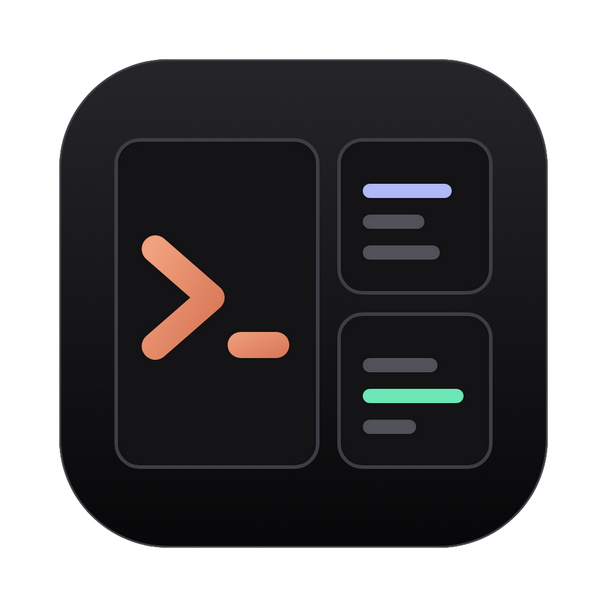
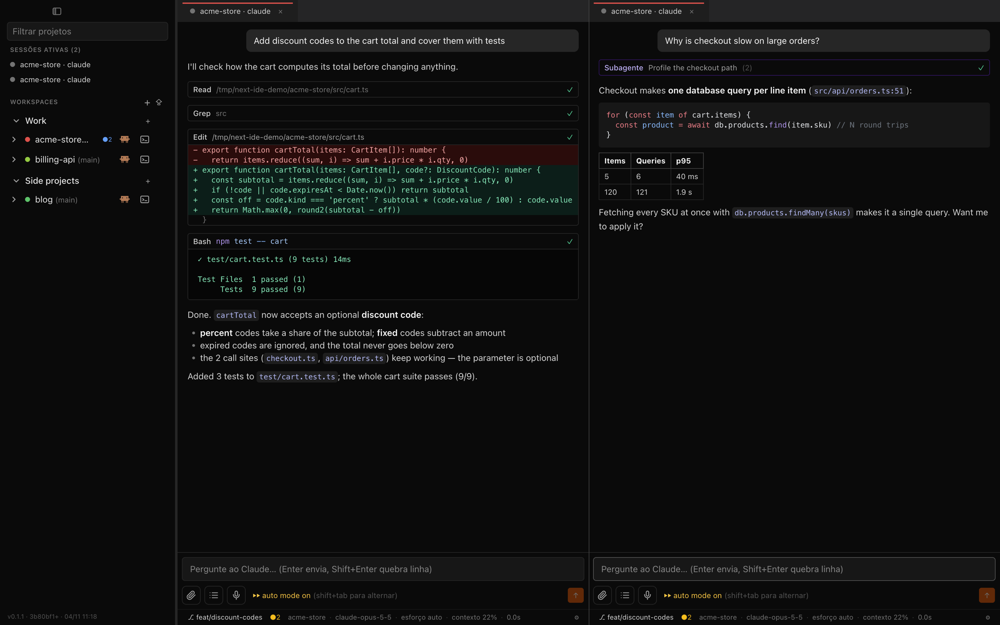
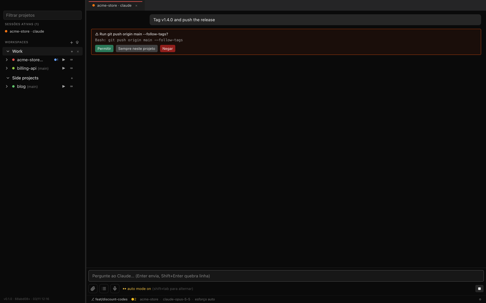
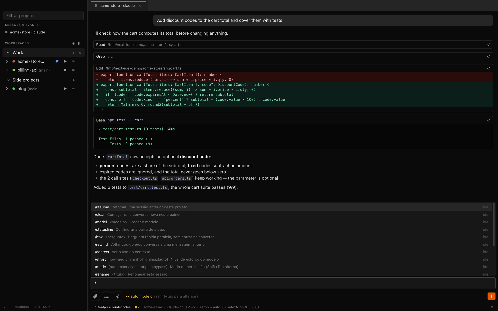
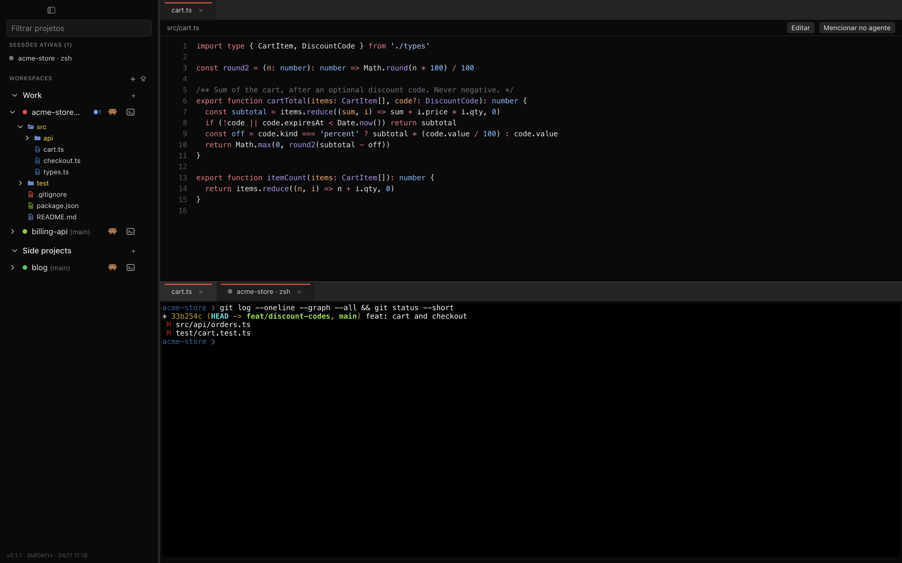
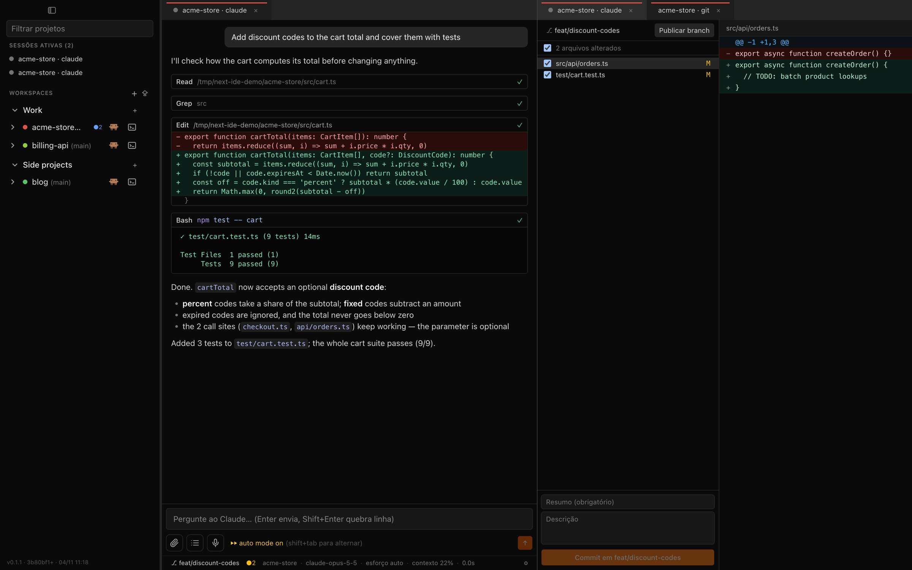
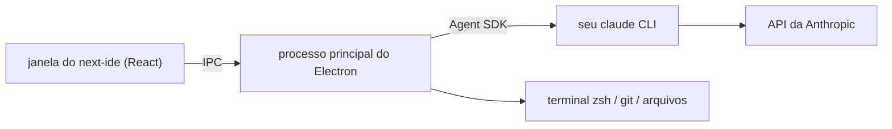
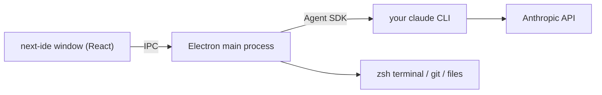

<div align="center">



# next-ide

**Várias sessões do Claude Code, de todos os seus projetos, lado a lado, numa janela só.**<br />
<sub>Run many Claude Code sessions across all your projects, side by side, in one window.</sub>

🇧🇷 [Português](#português) · 🇺🇸 [English](#english)

[Site / Website](https://thiagolopes-dev.github.io/next-ide/) · [Download](https://github.com/thiagolopes-dev/next-ide/releases/latest)



</div>

<a id="português"></a>

## 🇧🇷 Português

App desktop nativo para macOS construído sobre o seu próprio `claude` CLI: chat de verdade, painéis divididos, terminal, arquivos e Git, sem malabarismo com abas de terminal.

[Recursos](#recursos) · [Instalação](#instalação) · [Atalhos](#atalhos) · [Compilar do código](#compilar-do-código) · [Segurança](#segurança-e-privacidade) · [Dúvidas](#dúvidas)

### Por quê

O Claude Code no terminal é ótimo até você ter cinco projetos rodando ao mesmo tempo. Aí vira uma parede de abas, você perde de vista qual sessão está esperando por você, e o VS Code dá um chat só por janela.

O next-ide põe todos os projetos numa barra lateral, agrupados em workspaces. Você abre quantas sessões do Claude quiser, divide a tela entre elas e vê de relance quais estão rodando, esperando permissão ou prontas.

### Recursos

**Agente**
- Chat do Claude Code com respostas em streaming, Markdown, código com destaque de sintaxe e cards de ferramenta com diff das edições
- Pedidos de permissão no próprio chat (permitir uma vez, sempre neste projeto, negar) e todos os modos do CLI: manual, aceitar edições, plan, auto e bypass (`Shift+Tab` alterna entre os quatro primeiros; bypass só se escolhe à mão, com `/mode`)
- Comandos `/` do CLI e da IDE: `/resume`, `/clear`, `/model`, `/effort`, `/mode`, `/context`, `/rewind`, `/fork`, `/btw`, `/rename`, `/mcp`, `/agents`, `/add-dir`, `/statusline` e outros
- Menções com `@` a arquivos e subagentes, colar e arrastar imagens, tarefas em segundo plano (`Ctrl+B`)
- Barra de status configurável: branch, modelo, esforço, uso de contexto, tokens e duração, ou um script seu
- As sessões são sessões normais do Claude Code: aparecem no `/resume` do CLI, e as do CLI aparecem aqui
- Notificações do macOS quando uma sessão termina ou precisa de você

**Ambiente**
- Workspaces nomeados que você reordena arrastando; importa `.code-workspace` do VS Code
- Painéis encaixáveis e divisíveis (`Cmd+\` à direita, `Cmd+Shift+\` abaixo); o layout volta ao reabrir
- Terminal zsh embutido (xterm.js + node-pty)
- Árvore de arquivos, visualizador e editor com destaque de sintaxe, e `Cmd+P` para abrir arquivos rápido
- Painel Git para selecionar, commitar, publicar e sincronizar, e troca de branch pela barra de status
- Ditado por voz no composer, processado no próprio Mac (nada sai da máquina)
- Transparência e desfoque do fundo da janela

<table>
  <tr>
    <td width="50%"><br /><sub>Pedidos de permissão no chat</sub></td>
    <td width="50%"><br /><sub>Comandos do CLI e da IDE</sub></td>
  </tr>
  <tr>
    <td width="50%"><br /><sub>Árvore de arquivos, visualizador e terminal</sub></td>
    <td width="50%"><br /><sub>Painel Git ao lado do agente</sub></td>
  </tr>
</table>

### Como funciona

O next-ide não reimplementa o Claude Code. Ele usa o [Claude Agent SDK](https://docs.claude.com/en/api/agent-sdk/overview) apontado para **o binário `claude` que você já tem instalado**. Por isso:

- usa o seu login atual (assinatura Pro/Max ou API key), que o next-ide nunca vê nem guarda
- carrega seus `CLAUDE.md`, settings, hooks, servidores MCP, skills e regras de permissão do mesmo jeito que o CLI
- tem o mesmo modelo, a mesma velocidade e o mesmo prompt caching. O tempo vai para o modelo e para as ferramentas, igual no terminal. O único custo extra são alguns milissegundos para desenhar o chat.



### Instalação

**Requisitos:** Mac (Apple Silicon ou Intel) com macOS 13 ou mais novo (o ditado por voz precisa do macOS 26+), e o [Claude Code](https://docs.claude.com/en/docs/claude-code) instalado e logado. Rodar `claude` no terminal tem que funcionar.

1. Baixe o DMG mais recente em [Releases](https://github.com/thiagolopes-dev/next-ide/releases/latest): `next-ide-<versão>-arm64.dmg` para Apple Silicon (M1 em diante), `next-ide-<versão>-x64.dmg` para Intel. Na dúvida: menu Apple → Sobre Este Mac → Chip / Processador.
2. Abra o DMG e arraste o **next-ide** para **Aplicativos**.
3. Abra o next-ide. As releases são assinadas com Developer ID e notarizadas pela Apple, então o macOS abre sem avisos.
4. Clique em **+** para criar um workspace, adicione a pasta de um projeto e aperte **▶** para abrir o Claude nela.

O next-ide acha o `claude` pelo `PATH` do seu shell de login e, se não achar, tenta `~/.local/bin/claude`. Se ele estiver em outro lugar, defina `"claudePath"` em `~/Library/Application Support/next-ide/settings.json`.

#### Windows

1. Baixe `next-ide-<versão>-setup-x64.exe` (instalador) ou `next-ide-<versão>-portable-x64.exe` (roda sem instalar). Eles são gerados pelo workflow **Windows** (`.github/workflows/windows.yml`), ou localmente com `npm run dist:win`.
2. O `.exe` não é assinado: na primeira vez o SmartScreen mostra um aviso. Clique em **Mais informações → Executar assim mesmo**.
3. Instale o Claude Code no Windows (o next-ide procura `claude.exe` no `PATH` e em `%USERPROFILE%\.local\bin`). Se não achar, usa o Claude que vem dentro do app. O terminal integrado abre o PowerShell.
4. No Windows os atalhos usam `Ctrl` no lugar de `Cmd` (alternar a barra lateral é `Ctrl+Shift+B`, para `Ctrl+B` continuar mandando a tarefa para segundo plano). O ditado por voz, a transparência e o desfoque da janela são só do macOS. As configurações ficam em `%APPDATA%\next-ide\settings.json`.

### Atalhos

| Atalho | Ação |
| --- | --- |
| `Cmd+\` / `Cmd+Shift+\` | Divide o painel ativo à direita / abaixo |
| `Cmd+1` … `Cmd+9` | Foca um grupo de painéis |
| `Cmd+W` | Fecha a aba ativa |
| `Cmd+P` | Abre um arquivo rápido |
| `Shift+Tab` | Alterna o modo de permissão |
| `Ctrl+B` | Manda a tarefa atual para segundo plano |
| `Enter` / `Shift+Enter` | Envia / quebra linha |

### Compilar do código

Precisa de Node.js 22 e das Xcode Command Line Tools (para o módulo nativo do terminal e o helper de ditado em Swift).

```bash
git clone https://github.com/thiagolopes-dev/next-ide.git
cd next-ide
npm install
npm run dev        # roda em desenvolvimento com hot reload
npm run dist       # gera os DMGs arm64 e x64 em dist/
npm run dist:win   # gera o instalador e o .exe portátil do Windows em dist/
```

Outros scripts:

| Script | O que faz |
| --- | --- |
| `npm test` | Testes unitários (Vitest) |
| `npm run test:e2e` | Testes ponta a ponta (Playwright + Electron), com um agente falso roteirizado, sem rede |
| `npm run typecheck` | Checagem de TypeScript |
| `npm run package` | Gera `dist/mac-arm64/next-ide.app` sem DMG |
| `npm run screenshots` | Refaz as imagens deste README com dados de demonstração |

As releases saem pelo GitHub Actions: enviar uma tag `v*` gera os DMGs e os anexa a uma GitHub Release (`.github/workflows/release.yml`).

**Estrutura do projeto**

```
src/main        Processo principal do Electron: sessões do agente (Agent SDK), terminal (node-pty), arquivos, git, IPC
src/preload     A ponte tipada e enxuta exposta à janela
src/renderer    Interface React: barra lateral, painéis, chat, visualizador de arquivos, painel Git
src/shared      Tipos e lógica pura usados pelos dois lados
src/native      Helper em Swift para o ditado no próprio Mac
e2e/ test/      Suítes Playwright e Vitest
site/           O site do projeto (GitHub Pages)
docs/           Specs e planos de design
```

### Segurança e privacidade

- **Sem contas, sem servidores, sem telemetria.** O next-ide só conversa com o processo `claude` local. Suas credenciais da Anthropic ficam com o Claude Code.
- **A janela roda isolada**: `contextIsolation` e `sandbox` ligados, sem integração com Node, Content Security Policy rígida no build de produção e navegação dentro da janela bloqueada. O processo principal confere todo acesso a arquivos contra as pastas dos seus workspaces.
- **As permissões são as do Claude Code**: o next-ide mostra os mesmos pedidos e respeita as mesmas regras e modos. O modo bypass nunca liga sozinho, só se você escolher.
- **Dados locais**: workspaces, layout e configurações ficam em `~/Library/Application Support/next-ide`. As conversas quem guarda é o próprio Claude Code, em `~/.claude`.
- **O ditado** roda no próprio Mac, com o framework de fala da Apple, e só enquanto o botão do microfone está ligado.

Achou uma vulnerabilidade? Veja o [SECURITY.md](SECURITY.md).

### Dúvidas

**É mais lento que o CLI?**
Não. Cada sessão é o seu próprio `claude` rodando por trás do Agent SDK, então as respostas demoram o mesmo que no terminal. A primeira mensagem de uma aba nova espera um ou dois segundos enquanto o CLI inicia e carrega seus servidores MCP, o que o terminal faz quando você o abre.

**Funciona com API key em vez de assinatura?**
Sim. Funciona com o que o `claude` estiver usando para entrar.

**Windows ou Linux?**
Ainda não. Por enquanto o app é só para macOS (shell, atalhos e ditado são específicos do Mac). Contribuições são bem-vindas.

### Contribuindo

Issues e pull requests são bem-vindos. Antes de abrir um PR, rode `npm run typecheck && npm test && npm run test:e2e`.

### Licença

[MIT](LICENSE) © Thiago Lopes

O next-ide é um projeto independente, sem vínculo com a Anthropic e sem endosso dela. Claude e Claude Code são marcas da Anthropic, PBC.

---

<a id="english"></a>

## 🇺🇸 English

A native macOS desktop app built on top of your own `claude` CLI: real chat UI, split panes, terminal, files and Git, without juggling terminal tabs.

[Features](#features) · [Install](#install) · [Shortcuts](#keyboard-shortcuts) · [Build from source](#build-from-source) · [Security](#security-and-privacy) · [FAQ](#faq)

### Why

Claude Code in a terminal is great until you have five projects going at once. You end up with a wall of terminal tabs, you lose track of which session is waiting for you, and VS Code gives each window just one chat.

next-ide puts every project in a sidebar, grouped into workspaces. You can open as many Claude sessions as you want, split them on screen, and see at a glance which ones are running, waiting for permission or done.

### Features

**Agent**
- Chat UI for Claude Code: streaming answers, Markdown, syntax-highlighted code, and tool cards with inline diffs for edits
- Permission prompts in the chat (allow once, always for this project, deny), with all the CLI modes: manual, accept edits, plan, auto and bypass (`Shift+Tab` cycles through the first four; bypass is only ever picked by hand with `/mode`)
- Slash commands, both the CLI's and the IDE's: `/resume`, `/clear`, `/model`, `/effort`, `/mode`, `/context`, `/rewind`, `/fork`, `/btw`, `/rename`, `/mcp`, `/agents`, `/add-dir`, `/statusline` and more
- `@` mentions for files and subagents, image paste and drop, and background tasks (`Ctrl+B`)
- Configurable status line: branch, model, effort, context usage, tokens and duration, or your own script
- Sessions are regular Claude Code sessions, so they show up in the CLI's `/resume` and the other way round
- macOS notifications when a session finishes or needs you

**Workspace**
- Named workspaces you can drag to reorder; import a VS Code `.code-workspace`
- Dockable, splittable panes (`Cmd+\` right, `Cmd+Shift+\` below); the layout is restored on launch
- Built-in zsh terminal (xterm.js + node-pty)
- File tree, a fast syntax-highlighted viewer and editor, and `Cmd+P` quick open
- Git panel to stage, commit, publish and sync, plus a branch switcher in the status line
- On-device voice dictation in the composer (macOS Speech, nothing leaves your Mac)
- Window transparency and background blur

<table>
  <tr>
    <td width="50%"><br /><sub>Permission prompts right in the chat</sub></td>
    <td width="50%"><br /><sub>CLI and IDE slash commands</sub></td>
  </tr>
  <tr>
    <td width="50%"><br /><sub>File tree, viewer and terminal</sub></td>
    <td width="50%"><br /><sub>Git panel next to the agent</sub></td>
  </tr>
</table>

### How it works

next-ide doesn't reimplement Claude Code. It uses the [Claude Agent SDK](https://docs.claude.com/en/api/agent-sdk/overview) pointed at **the `claude` binary you already have installed**, so you get:

- your existing login (Pro/Max subscription or API key); next-ide never sees or stores it
- your `CLAUDE.md` files, settings, hooks, MCP servers, skills and permission rules, loaded exactly as the CLI loads them
- the same model, the same speed and the same prompt caching. The time goes to the model and to tool runs, same as in the terminal. The only extra cost is a few milliseconds to render the chat.



### Install

**Requirements:** a Mac (Apple Silicon or Intel) on macOS 13 or newer (voice dictation needs macOS 26+), and [Claude Code](https://docs.claude.com/en/docs/claude-code) installed and logged in. Running `claude` in your terminal should work.

1. Download the latest DMG from [Releases](https://github.com/thiagolopes-dev/next-ide/releases/latest): `next-ide-<version>-arm64.dmg` for Apple Silicon (M1 and later), `next-ide-<version>-x64.dmg` for Intel. Not sure which? Apple menu → About This Mac → Chip / Processor.
2. Open it and drag **next-ide** to **Applications**.
3. Open next-ide. Release builds are signed with a Developer ID and notarized by Apple, so macOS opens them without warnings.
4. Click **+** to create a workspace, add a project folder, and press **▶** to start Claude in it.

next-ide finds `claude` through your login shell's `PATH`, falling back to `~/.local/bin/claude`. If it lives somewhere else, set `"claudePath"` in `~/Library/Application Support/next-ide/settings.json`.

#### Windows

1. Download `next-ide-<version>-setup-x64.exe` (installer) or `next-ide-<version>-portable-x64.exe` (runs without installing). They are built by the **Windows** workflow (`.github/workflows/windows.yml`), or locally with `npm run dist:win`.
2. The `.exe` is unsigned: the first launch shows a SmartScreen warning. Click **More info → Run anyway**.
3. Install Claude Code for Windows (next-ide looks for `claude.exe` on `PATH` and in `%USERPROFILE%\.local\bin`). If none is found it uses the one bundled with the app. The built-in terminal opens PowerShell.
4. On Windows the shortcuts use `Ctrl` instead of `Cmd` (toggling the sidebar is `Ctrl+Shift+B`, so `Ctrl+B` still sends the task to the background). Voice dictation and window transparency/blur are macOS only. Settings live in `%APPDATA%\next-ide\settings.json`.

### Keyboard shortcuts

| Shortcut | Action |
| --- | --- |
| `Cmd+\` / `Cmd+Shift+\` | Split the active pane right / below |
| `Cmd+1` … `Cmd+9` | Focus pane group |
| `Cmd+W` | Close the active tab |
| `Cmd+P` | Quick open a file |
| `Shift+Tab` | Cycle permission mode |
| `Ctrl+B` | Send the running task to the background |
| `Enter` / `Shift+Enter` | Send / new line |

### Build from source

Requires Node.js 22 and the Xcode Command Line Tools (for the native terminal module and the Swift dictation helper).

```bash
git clone https://github.com/thiagolopes-dev/next-ide.git
cd next-ide
npm install
npm run dev        # run in development with hot reload
npm run dist       # build the arm64 and x64 DMGs in dist/
npm run dist:win   # build the Windows installer and portable .exe in dist/
```

Other scripts:

| Script | What it does |
| --- | --- |
| `npm test` | Unit tests (Vitest) |
| `npm run test:e2e` | End-to-end tests (Playwright + Electron), using a scripted fake agent with no network |
| `npm run typecheck` | TypeScript check |
| `npm run package` | Build `dist/mac-arm64/next-ide.app` without a DMG |
| `npm run screenshots` | Regenerate the README screenshots with demo data |

Releases are built by GitHub Actions: pushing a `v*` tag builds the DMGs and attaches them to a GitHub Release (`.github/workflows/release.yml`).

**Project layout**

```
src/main        Electron main process: agent sessions (Agent SDK), terminal (node-pty), files, git, IPC
src/preload     The narrow, typed bridge exposed to the window
src/renderer    React UI: sidebar, dock panes, chat, file viewer, Git panel
src/shared      Types and pure logic shared by both sides
src/native      Swift helper for on-device dictation
e2e/ test/      Playwright and Vitest suites
site/           The project website (GitHub Pages)
docs/           Design specs and plans
```

### Security and privacy

- **No accounts, no servers, no telemetry.** next-ide talks only to your local `claude` process. Your Anthropic credentials stay with Claude Code.
- **The renderer is sandboxed**: `contextIsolation`, `sandbox` on, no Node integration, a strict Content Security Policy in production builds, and in-window navigation is blocked. The main process checks file access against your workspace folders.
- **Permissions are Claude Code's**: next-ide shows the same permission prompts and honours the same rules and modes. Bypass mode is never turned on by itself; you have to pick it.
- **Local data**: workspaces, layout and settings live in `~/Library/Application Support/next-ide`. Conversations are stored by Claude Code itself, in `~/.claude`.
- **Dictation** runs on device with Apple's Speech framework, and only while the mic button is on.

Found a vulnerability? See [SECURITY.md](SECURITY.md).

### FAQ

**Is it slower than the CLI?**
No. Each session is your own `claude` running behind the Agent SDK. Responses take as long as they would in the terminal. The first message in a new tab waits a second or two while the CLI starts and loads your MCP servers, which the terminal does when you open it.

**Does it work with an API key instead of a subscription?**
Yes. It works with whatever `claude` is logged in with.

**Windows or Linux?**
Not yet. The app is macOS-only for now (shell, shortcuts and dictation are Mac-specific). Contributions are welcome.

### Contributing

Issues and pull requests are welcome. Before opening a PR, run `npm run typecheck && npm test && npm run test:e2e`.

### License

[MIT](LICENSE) © Thiago Lopes

next-ide is an independent project. It is not affiliated with or endorsed by Anthropic. Claude and Claude Code are trademarks of Anthropic, PBC.
