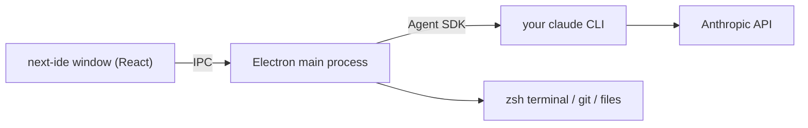

<div align="center">


# next-ide

**Run many Claude Code sessions across all your projects, side by side, in one window.**

A native macOS desktop app built on top of your own `claude` CLI: real chat UI, split panes, terminal, files and Git, without juggling terminal tabs.

[Website](https://thiagolopes-dev.github.io/next-ide/) · [Download](https://github.com/thiagolopes-dev/next-ide/releases/latest) · [Features](#features) · [Install](#install) · [Build from source](#build-from-source) · [Português](README.pt-BR.md)


</div>

## Why

Claude Code in a terminal is great until you have five projects going at once. You end up with a wall of terminal tabs, you lose track of which session is waiting for you, and VS Code gives each window just one chat.

next-ide puts every project in a sidebar, grouped into workspaces. You can open as many Claude sessions as you want, split them on screen, and see at a glance which ones are running, waiting for permission or done.

## Features

**Agent**
- Chat UI for Claude Code: streaming answers, Markdown, syntax-highlighted code, and tool cards with inline diffs for edits
- Permission prompts in the chat (allow once, always for this project, deny), with all the CLI modes: manual, accept edits, plan, auto and bypass (`Shift+Tab` cycles through the first four; bypass is only ever picked by hand with `/mode`)
- Slash commands, both the CLI's and the IDE's: `/resume`, `/clear`, `/model`, `/effort`, `/mode`, `/context`, `/rewind`, `/fork`, `/btw`, `/rename`, `/mcp`, `/agents`, `/add-dir`, `/statusline` and more
- `@` mentions for files and subagents, image paste and drop, and background tasks (`Ctrl+B`)
- Configurable status line: branch, model, effort, context usage, tokens and duration, or your own script
- Sessions are regular Claude Code sessions, so they show up in the CLI's `/resume` and the other way round
- macOS notifications when a session finishes or needs you

**Workspace**
- Named workspaces you can drag to reorder; import a VS Code `.code-workspace`
- Dockable, splittable panes (`Cmd+\` right, `Cmd+Shift+\` below); the layout is restored on launch
- Built-in zsh terminal (xterm.js + node-pty)
- File tree, a fast syntax-highlighted viewer and editor, and `Cmd+P` quick open
- Git panel to stage, commit, publish and sync, plus a branch switcher in the status line
- On-device voice dictation in the composer (macOS Speech, nothing leaves your Mac)
- Window transparency and background blur

<table>
  <tr>
    <td width="50%"><br /><sub>Permission prompts right in the chat</sub></td>
    <td width="50%"><br /><sub>CLI and IDE slash commands</sub></td>
  </tr>
  <tr>
    <td width="50%"><br /><sub>File tree, viewer and terminal</sub></td>
    <td width="50%"><br /><sub>Git panel next to the agent</sub></td>
  </tr>
</table>

## How it works

next-ide doesn't reimplement Claude Code. It uses the [Claude Agent SDK](https://docs.claude.com/en/api/agent-sdk/overview) pointed at **the `claude` binary you already have installed**, so you get:

- your existing login (Pro/Max subscription or API key); next-ide never sees or stores it
- your `CLAUDE.md` files, settings, hooks, MCP servers, skills and permission rules, loaded exactly as the CLI loads them
- the same model, the same speed and the same prompt caching. The time goes to the model and to tool runs, same as in the terminal. The only extra cost is a few milliseconds to render the chat.



## Install

**Requirements:** a Mac (Apple Silicon or Intel) on macOS 13 or newer (voice dictation needs macOS 26+), and [Claude Code](https://docs.claude.com/en/docs/claude-code) installed and logged in. Running `claude` in your terminal should work.

1. Download the latest DMG from [Releases](https://github.com/thiagolopes-dev/next-ide/releases/latest): `next-ide-<version>-arm64.dmg` for Apple Silicon (M1 and later), `next-ide-<version>-x64.dmg` for Intel. Not sure which? Apple menu → About This Mac → Chip / Processor.
2. Open it and drag **next-ide** to **Applications**.
3. Open next-ide. Release builds are signed with a Developer ID and notarized by Apple, so macOS opens them without warnings.
4. Click **+** to create a workspace, add a project folder, and press **▶** to start Claude in it.

next-ide finds `claude` through your login shell's `PATH`, falling back to `~/.local/bin/claude`. If it lives somewhere else, set `"claudePath"` in `~/Library/Application Support/next-ide/settings.json`.

## Keyboard shortcuts

| Shortcut | Action |
| --- | --- |
| `Cmd+\` / `Cmd+Shift+\` | Split the active pane right / below |
| `Cmd+1` … `Cmd+9` | Focus pane group |
| `Cmd+W` | Close the active tab |
| `Cmd+P` | Quick open a file |
| `Shift+Tab` | Cycle permission mode |
| `Ctrl+B` | Send the running task to the background |
| `Enter` / `Shift+Enter` | Send / new line |

## Build from source

Requires Node.js 22 and the Xcode Command Line Tools (for the native terminal module and the Swift dictation helper).

```bash
git clone https://github.com/thiagolopes-dev/next-ide.git
cd next-ide
npm install
npm run dev        # run in development with hot reload
npm run dist       # build the arm64 and x64 DMGs in dist/
```

Other scripts:

| Script | What it does |
| --- | --- |
| `npm test` | Unit tests (Vitest) |
| `npm run test:e2e` | End-to-end tests (Playwright + Electron), using a scripted fake agent with no network |
| `npm run typecheck` | TypeScript check |
| `npm run package` | Build `dist/mac-arm64/next-ide.app` without a DMG |
| `npm run screenshots` | Regenerate the README screenshots with demo data |

Releases are built by GitHub Actions: pushing a `v*` tag builds the DMG and attaches it to a GitHub Release (`.github/workflows/release.yml`).

### Project layout

```
src/main        Electron main process: agent sessions (Agent SDK), terminal (node-pty), files, git, IPC
src/preload     The narrow, typed bridge exposed to the window
src/renderer    React UI: sidebar, dock panes, chat, file viewer, Git panel
src/shared      Types and pure logic shared by both sides
src/native      Swift helper for on-device dictation
e2e/ test/      Playwright and Vitest suites
docs/           Design specs and plans
```

## Security and privacy

- **No accounts, no servers, no telemetry.** next-ide talks only to your local `claude` process. Your Anthropic credentials stay with Claude Code.
- **The renderer is sandboxed**: `contextIsolation`, `sandbox` on, no Node integration, a strict Content Security Policy in production builds, and in-window navigation is blocked. The main process checks file access against your workspace folders.
- **Permissions are Claude Code's**: next-ide shows the same permission prompts and honours the same rules and modes. Bypass mode is never turned on by itself; you have to pick it.
- **Local data**: workspaces, layout and settings live in `~/Library/Application Support/next-ide`. Conversations are stored by Claude Code itself, in `~/.claude`.
- **Dictation** runs on device with Apple's Speech framework, and only while the mic button is on.

Found a vulnerability? See [SECURITY.md](SECURITY.md).

## FAQ

**Is it slower than the CLI?**
No. Each session is your own `claude` running behind the Agent SDK. Responses take as long as they would in the terminal. The first message in a new tab waits a second or two while the CLI starts and loads your MCP servers, which the terminal does when you open it.

**Does it work with an API key instead of a subscription?**
Yes. It works with whatever `claude` is logged in with.

**Windows or Linux?**
Not yet. The app is macOS-only for now (shell, shortcuts and dictation are Mac-specific). Contributions are welcome.

## Contributing

Issues and pull requests are welcome. Before opening a PR, run `npm run typecheck && npm test && npm run test:e2e`.

## License

[MIT](LICENSE) © Thiago Lopes

next-ide is an independent project. It is not affiliated with or endorsed by Anthropic. Claude and Claude Code are trademarks of Anthropic, PBC.
