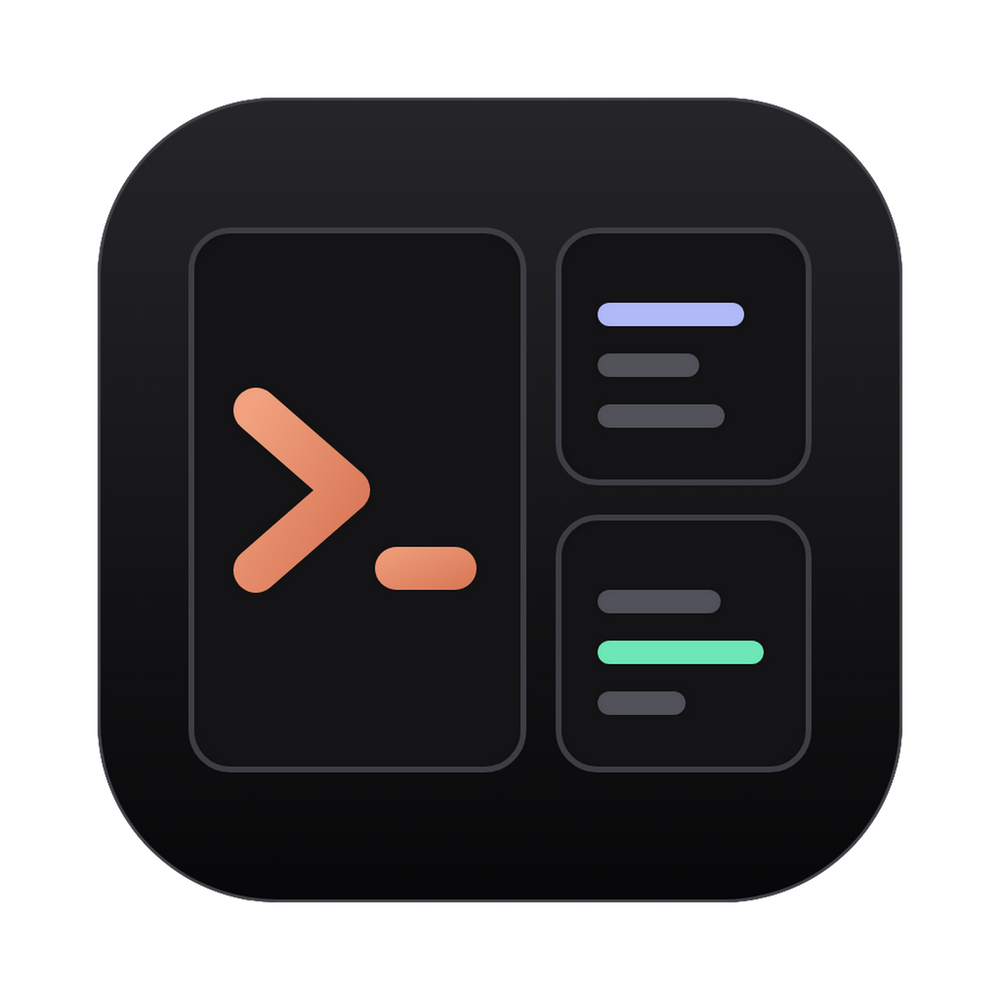
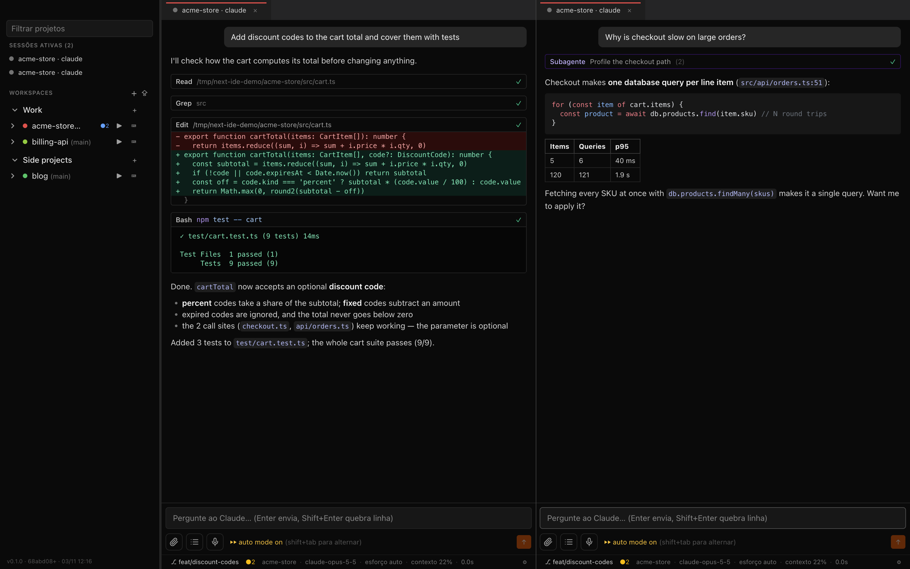
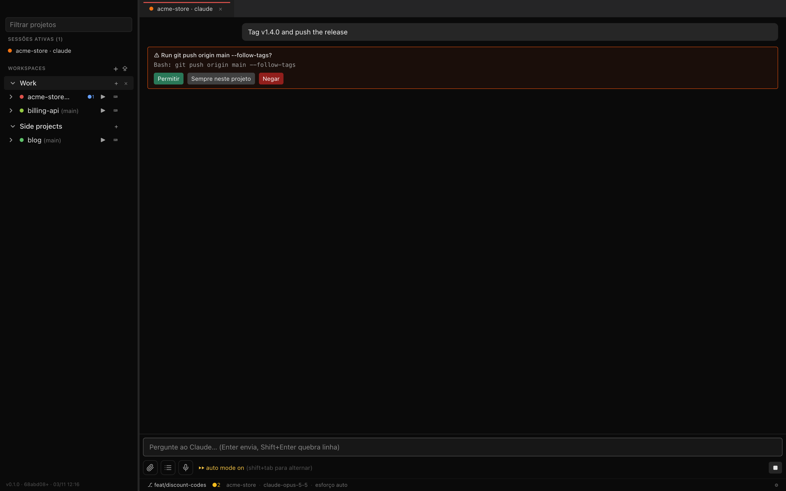
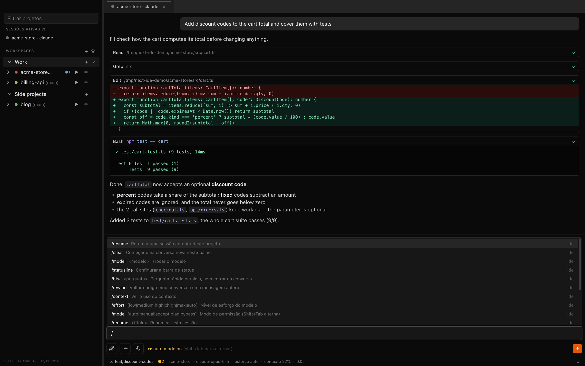
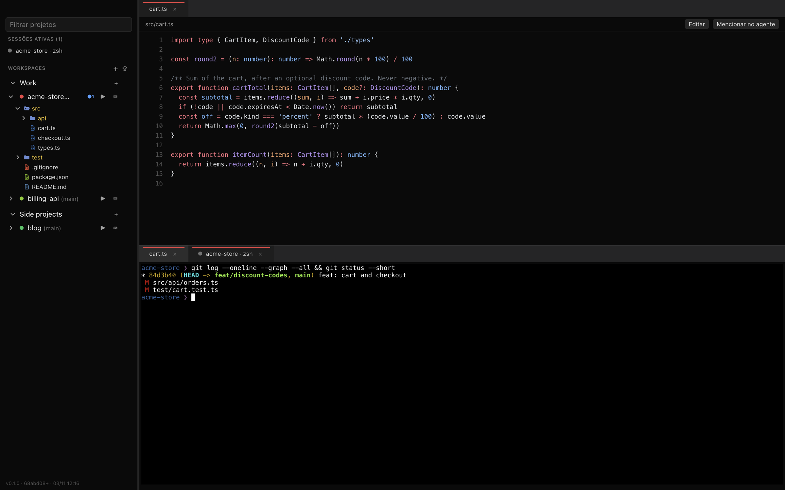
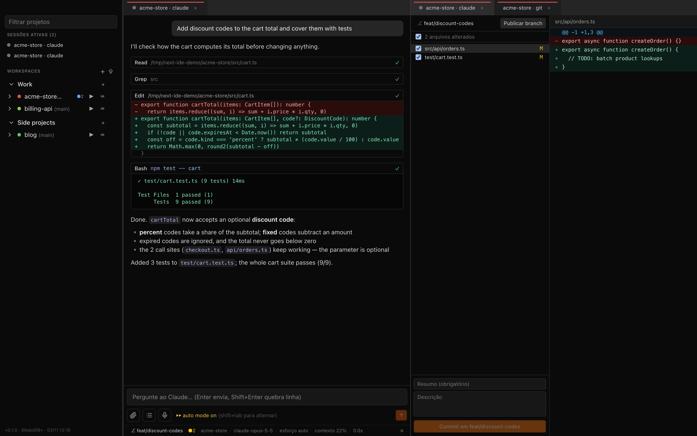

<div align="center">



# next-ide

**Várias sessões do Claude Code, de todos os seus projetos, lado a lado, numa janela só.**

App desktop nativo para macOS construído sobre o seu próprio `claude` CLI: chat de verdade, painéis divididos, terminal, arquivos e Git, sem malabarismo com abas de terminal.

[Download](https://github.com/thiagolopes-dev/next-ide/releases/latest) · [Recursos](#recursos) · [Instalação](#instalação) · [Compilar do código](#compilar-do-código) · [English](README.md)



</div>

## Por quê

O Claude Code no terminal é ótimo até você ter cinco projetos rodando ao mesmo tempo. Aí vira uma parede de abas, você perde de vista qual sessão está esperando por você, e o VS Code dá um chat só por janela.

O next-ide põe todos os projetos numa barra lateral, agrupados em workspaces. Você abre quantas sessões do Claude quiser, divide a tela entre elas e vê de relance quais estão rodando, esperando permissão ou prontas.

## Recursos

**Agente**
- Chat do Claude Code com respostas em streaming, Markdown, código com destaque de sintaxe e cards de ferramenta com diff das edições
- Pedidos de permissão no próprio chat (permitir uma vez, sempre neste projeto, negar) e todos os modos do CLI: manual, aceitar edições, plan, auto e bypass (`Shift+Tab` alterna entre os quatro primeiros; bypass só se escolhe à mão, com `/mode`)
- Comandos `/` do CLI e da IDE: `/resume`, `/clear`, `/model`, `/effort`, `/mode`, `/context`, `/rewind`, `/fork`, `/btw`, `/rename`, `/mcp`, `/agents`, `/add-dir`, `/statusline` e outros
- Menções com `@` a arquivos e subagentes, colar e arrastar imagens, tarefas em segundo plano (`Ctrl+B`)
- Barra de status configurável: branch, modelo, esforço, uso de contexto, tokens e duração, ou um script seu
- As sessões são sessões normais do Claude Code: aparecem no `/resume` do CLI, e as do CLI aparecem aqui
- Notificações do macOS quando uma sessão termina ou precisa de você

**Ambiente**
- Workspaces nomeados que você reordena arrastando; importa `.code-workspace` do VS Code
- Painéis encaixáveis e divisíveis (`Cmd+\` à direita, `Cmd+Shift+\` abaixo); o layout volta ao reabrir
- Terminal zsh embutido (xterm.js + node-pty)
- Árvore de arquivos, visualizador e editor com destaque de sintaxe, e `Cmd+P` para abrir arquivos rápido
- Painel Git para selecionar, commitar, publicar e sincronizar, e troca de branch pela barra de status
- Ditado por voz no composer, processado no próprio Mac (nada sai da máquina)
- Transparência e desfoque do fundo da janela

<table>
  <tr>
    <td width="50%"><br /><sub>Pedidos de permissão no chat</sub></td>
    <td width="50%"><br /><sub>Comandos do CLI e da IDE</sub></td>
  </tr>
  <tr>
    <td width="50%"><br /><sub>Árvore de arquivos, visualizador e terminal</sub></td>
    <td width="50%"><br /><sub>Painel Git ao lado do agente</sub></td>
  </tr>
</table>

## Como funciona

O next-ide não reimplementa o Claude Code. Ele usa o [Claude Agent SDK](https://docs.claude.com/en/api/agent-sdk/overview) apontado para **o binário `claude` que você já tem instalado**. Por isso:

- usa o seu login atual (assinatura Pro/Max ou API key), que o next-ide nunca vê nem guarda
- carrega seus `CLAUDE.md`, settings, hooks, servidores MCP, skills e regras de permissão do mesmo jeito que o CLI
- tem o mesmo modelo, a mesma velocidade e o mesmo prompt caching. O tempo vai para o modelo e para as ferramentas, igual no terminal. O único custo extra são alguns milissegundos para desenhar o chat.

## Instalação

**Requisitos:** Mac com Apple Silicon e macOS 13 ou mais novo (o ditado por voz precisa do macOS 26+), e o [Claude Code](https://docs.claude.com/en/docs/claude-code) instalado e logado. Rodar `claude` no terminal tem que funcionar.

1. Baixe o `next-ide-<versão>-arm64.dmg` mais recente em [Releases](https://github.com/thiagolopes-dev/next-ide/releases/latest).
2. Abra o DMG e arraste o **next-ide** para **Aplicativos**.
3. O app ainda não é notarizado pela Apple, então o macOS bloqueia a primeira abertura. Remova a quarentena uma vez:

   ```bash
   xattr -dr com.apple.quarantine /Applications/next-ide.app
   ```

4. Abra o next-ide, clique em **+** para criar um workspace, adicione a pasta de um projeto e aperte **▶** para abrir o Claude nela.

O next-ide acha o `claude` pelo `PATH` do seu shell de login e, se não achar, tenta `~/.local/bin/claude`. Se ele estiver em outro lugar, defina `"claudePath"` em `~/Library/Application Support/next-ide/settings.json`.

## Atalhos

| Atalho | Ação |
| --- | --- |
| `Cmd+\` / `Cmd+Shift+\` | Divide o painel ativo à direita / abaixo |
| `Cmd+1` … `Cmd+9` | Foca um grupo de painéis |
| `Cmd+W` | Fecha a aba ativa |
| `Cmd+P` | Abre um arquivo rápido |
| `Shift+Tab` | Alterna o modo de permissão |
| `Ctrl+B` | Manda a tarefa atual para segundo plano |
| `Enter` / `Shift+Enter` | Envia / quebra linha |

## Compilar do código

Precisa de Node.js 22 e das Xcode Command Line Tools (para o módulo nativo do terminal e o helper de ditado em Swift).

```bash
git clone https://github.com/thiagolopes-dev/next-ide.git
cd next-ide
npm install
npm run dev        # roda em desenvolvimento com hot reload
npm run dist       # gera dist/next-ide-<versão>-arm64.dmg
```

Testes: `npm test` (Vitest), `npm run test:e2e` (Playwright, com um agente falso roteirizado, sem rede) e `npm run typecheck`. Para refazer as imagens deste README com dados de demonstração: `npm run screenshots`.

As releases saem pelo GitHub Actions: enviar uma tag `v*` gera o DMG e o anexa a uma GitHub Release (`.github/workflows/release.yml`).

## Segurança e privacidade

- **Sem contas, sem servidores, sem telemetria.** O next-ide só conversa com o processo `claude` local. Suas credenciais da Anthropic ficam com o Claude Code.
- **A janela roda isolada**: `contextIsolation` e `sandbox` ligados, sem integração com Node, Content Security Policy rígida no build de produção e navegação dentro da janela bloqueada. O processo principal confere todo acesso a arquivos contra as pastas dos seus workspaces.
- **As permissões são as do Claude Code**: o next-ide mostra os mesmos pedidos e respeita as mesmas regras e modos. O modo bypass nunca liga sozinho, só se você escolher.
- **Dados locais**: workspaces, layout e configurações ficam em `~/Library/Application Support/next-ide`. As conversas quem guarda é o próprio Claude Code, em `~/.claude`.

Achou uma vulnerabilidade? Veja o [SECURITY.md](SECURITY.md).

## Licença

[MIT](LICENSE) © Thiago Lopes

O next-ide é um projeto independente, sem vínculo com a Anthropic e sem endosso dela. Claude e Claude Code são marcas da Anthropic, PBC.
